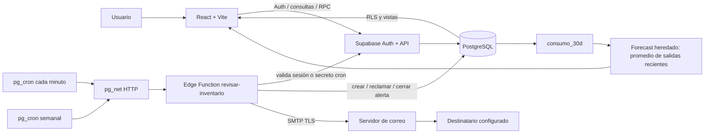

# Arquitectura de Control inteligente de inventario

## Stack

| Capa | Tecnología | Versión/configuración observada |
|---|---|---|
| Interfaz | JavaScript, React, React Router, Vite | React 19.3, Router 7.18, Vite 8.3 (rangos en `web/package.json`) |
| Datos y autenticación | Supabase Auth y PostgreSQL | Servicio administrado; versión del servidor remoto no detectable desde este checkout |
| API de datos | `@supabase/supabase-js` y RPC SQL | Supabase JS 2.117 |
| Automatización | Supabase Edge Functions (Deno/TypeScript), pg_cron, pg_net | Revisión de stock cada minuto; reporte semanal lunes 14:00 UTC |
| Correo | Nodemailer por SMTP | Host/puerto/credenciales se configuran como secrets del proyecto Supabase |
| Despliegue de frontend | Vercel | `web/vercel.json` configura fallback de SPA; no se confirmó URL desplegada |
| Excel | ExcelJS | Importación y exportación desde la aplicación |

Los números son las versiones/rangos declarados por el manifiesto y lockfile local. No se inspeccionó un entorno desplegado para obtener la versión del motor Postgres o confirmar servicios activos.

## Componentes y flujo de datos



## Entidades de base de datos heredadas

```mermaid
erDiagram
  PRODUCTS {
    bigint id PK
    text codigo UK
    text nombre
    text categoria
    integer stock_actual
    integer stock_minimo
    numeric costo
    boolean low_active
  }
  MOVEMENTS {
    bigint id PK
    text product_code
    text product_name
    text tipo
    text motivo
    integer cantidad
    integer stock_anterior
    integer stock_nuevo
    timestamptz created_at
  }
  ALERTS {
    bigint id PK
    timestamptz created_at
    jsonb items
    text subject
    text body
    text status
    text error
    integer attempts
    timestamptz last_attempt_at
    text recipient
    text message_id
    text delivery_status
    bigint proveedor_id FK
    bigint orden_id FK
  }
  SETTINGS {
    text key PK
    text value
  }
  PROFILES {
    uuid user_id PK
    text role
    boolean active
  }
  PROVEEDORES {
    bigint id PK
    text nombre
    text correo
    integer lead_time_dias
    numeric minimo_compra (legado; ignorado por la aplicación)
  }
  PROVEEDOR_PRODUCTOS {
    bigint proveedor_id FK
    bigint product_id FK
    numeric costo_unitario
    integer minimo_unidades
  }
  ORDENES_COMPRA {
    bigint id PK
    text folio UK
    bigint proveedor_id FK
    text estado
    uuid creada_por FK
    bigint alerta_id FK
    bigint email_alert_id FK
  }
  ORDEN_LINEAS {
    bigint id PK
    bigint orden_id FK
    bigint product_id FK
    integer cantidad
    integer recibida
    numeric costo_unitario
  }
  PRODUCTS ||--o{ MOVEMENTS : "product_code (histórico textual)"
  ALERTS }o..o{ PRODUCTS : "items JSONB snapshot"
  PROFILES ||--o{ ORDENES_COMPRA : "creada_por"
  PROVEEDORES ||--o{ PROVEEDOR_PRODUCTOS : surte
  PRODUCTS ||--o{ PROVEEDOR_PRODUCTOS : catálogo
  PROVEEDORES ||--o{ ORDENES_COMPRA : recibe
  ORDENES_COMPRA ||--|{ ORDEN_LINEAS : contiene
  PRODUCTS ||--o{ ORDEN_LINEAS : compra
  ALERTS o|--o| ORDENES_COMPRA : "alerta de origen"
```

`movements.product_code` se guarda como texto para conservar historial aunque se elimine un producto; por ello el vínculo no es una FK. `alerts.items` es una instantánea JSON de los artículos incluidos en el aviso.

## Pronóstico y selección

La línea base heredada toma salidas agregadas por `consumo_30d` y calcula el consumo diario para estimar duración de stock y reabastecimiento. Se mantiene en `web/src/lib/pronostico.js`. Las nuevas salidas se etiquetan; `ventas_diarias_365d` solo expone motivo `venta`.

`web/src/lib/pronostico-avanzado.js` construye una serie diaria, compara baseline, promedio ponderado, suavizamiento exponencial y factores por semana/mes mediante validación walk-forward, y devuelve modelo elegido, demanda, fecha de agotamiento e intervalo. La página del inventario lo integra. El scheduler SQL usa ponderación de ventas a 28 días y recurre a `consumo_30d` cuando todavía no hay ventas; no replica aún la selección estacional completa de la interfaz.

## Flujo de alerta heredado

1. `crear_alerta_stock_bajo()` detecta productos con stock menor al mínimo y registra una instantánea.
2. `low_active` evita crear avisos repetidos mientras siga activo el mismo episodio.
3. La Edge Function lista pendientes y `reclamar_alerta()` toma cada alerta para evitar envíos concurrentes.
4. Con SMTP configurado, Nodemailer envía HTML y texto plano. Sin configuración o con `DEMO_MODE=true`, guarda estado `simulado`.
5. La función registra destinatario, ID de mensaje, estado SMTP, número de intentos, hora del intento y error. Una respuesta SMTP aceptada no demuestra por sí sola entrega final en la bandeja.
6. Una orden borrador requiere acción manual de un usuario compras/admin; se manda al correo del proveedor y el alert queda relacionado a la orden. En demo se simula y no cambia a enviada.

## Seguridad y despliegue

- Supabase Auth autentica las sesiones del frontend.
- RLS restringe lectura/escritura a usuarios autenticados según políticas actuales; el `service_role` lo usa el backend automatizado.
- La Edge Function acepta una sesión válida o el secreto `x-cron-secret`; `CRON_SECRET` y SMTP deben vivir en Secrets/Vault.
- El frontend requiere `VITE_SUPABASE_URL` y `VITE_SUPABASE_KEY` en un archivo local ignorado por Git.
- `pg_cron` y `pg_net` residen en el proyecto Supabase y llaman la función; no dependen de que el navegador esté abierto.

## Retos técnicos identificados y respuesta de ampliación

| Reto | Enfoque |
|---|---|
| Revisión desatendida cada minuto | Mantener `pg_cron` + `pg_net` y su autenticación por secreto; no mover el scheduler al navegador |
| Duplicados o concurrencia | Preservar la reclamación transaccional y añadir enfriamiento/deduplicación documentada |
| Entrega externa comprobable | Guardar aceptación, ID de mensaje y resultado disponible; usar webhooks solo si el proveedor seleccionado los ofrece |
| Pocos datos y demanda estacional | Generar serie sintética con semilla, comparar por validación temporal y degradar a baseline con poco historial |
| Ventas mezcladas con otras salidas | Añadir un motivo compatible; los movimientos antiguos quedarán clasificados como heredados/desconocidos |
| Permisos demasiado amplios | Aplicar roles mediante backend/RLS/RPC, no solo mediante controles visuales |
| Compras con riesgo de destinatario externo | `DEMO_MODE=true` fuerza simulación; el envío a proveedor necesita acción manual y rol compras/admin |
| Credenciales no disponibles | Mantener modo demo visible y dar instrucciones reproducibles para configurar SMTP real |

## Resultados medibles

Se completará con salidas reproducibles de `docs/EVALUACION_PRONOSTICO.md`, pruebas y configuración real del proveedor de correo. A la fecha de auditoría no se declaran porcentajes de mejora, cobertura ni tasa de entrega: las pruebas no pudieron ejecutarse en el entorno y no hay credenciales SMTP configuradas localmente.
