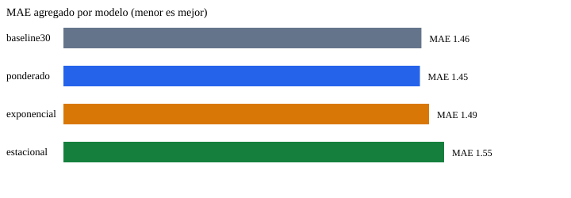

# Evaluación reproducible del pronóstico

## Datos y método

Datos completamente sintéticos: 18 productos, 365 días, semilla 4172026. Incluyen patrones estables, tendencia, día de semana, temporada de fin de año, demanda intermitente y picos. No representan ventas reales. Se usa validación temporal walk-forward con cinco orígenes por producto y horizonte de 14 días; ningún origen entrena con fechas futuras. Ejecutar `python scripts/evaluar_pronostico.py` para regenerar tabla y gráfica.

## Resultados agregados

| Modelo | MAE (u./día) | RMSE | sMAPE | WAPE | Sesgo | Mejora MAE vs baseline | Desabastos adicionales anticipados* |
|---|---:|---:|---:|---:|---:|---:|---:|
| baseline30 | 1.457 | 1.814 | 41.52% | 41.84% | +0.035 | +0.00% | — |
| ponderado | 1.451 | 1.815 | 42.13% | 40.85% | -0.156 | +0.42% | 0 |
| exponencial | 1.488 | 1.870 | 43.60% | 39.62% | -0.188 | -2.13% | 0 |
| estacional | 1.549 | 1.907 | 43.61% | 44.08% | -0.076 | -6.34% | 1 |

*Se cuentan episodios sintéticos donde el baseline no pronostica agotamiento en 7 días para el stock de referencia definido por el script, pero sí lo detecta el modelo evaluado. Es una simulación acotada y no una tasa real de desabasto.

La selección automática por producto debe evaluarse por separado en la aplicación; el ganador global de esta tabla no se presupone como el mejor para todos los productos. Los datos sintéticos pueden favorecer a los modelos que conocen los patrones generadores; los resultados no prueban una mejora en ventas reales.
